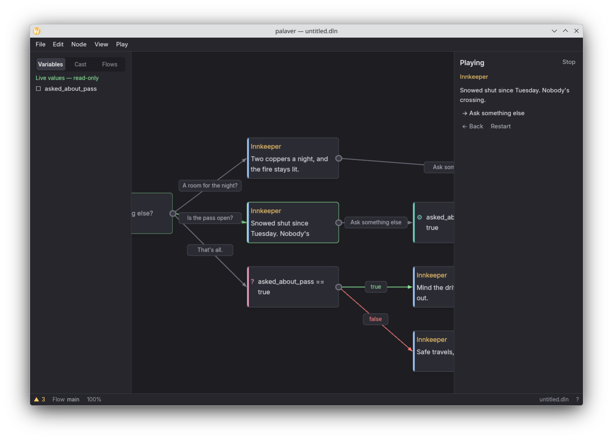

# palaver

A node-graph editor for branching game dialogue, in the spirit of articy:draft, written in Rust
with GPUI, the UI framework Zed is built on.



## What it is

You write a conversation as a graph. Speech nodes hold a speaker and a line, the edges between
them are the player's choices, and a few other node kinds carry the logic: hubs to branch
from, conditions and instructions to read and set variables, jumps to go elsewhere, and
notes for the author. Press F5 and the editor plays the conversation right there, walking the
graph the way a game would.

Around that sit the things a real project needs: document-wide variables, a cast of characters,
several canvases (flows) in one file, full undo, and a problems list for dead ends and broken
links. Documents are plain JSON (`.dln`), and the lines a player reads export to Fluent (`.ftl`)
for translation.

## Making it legible

The first working version looked like a lot of tools written with an AI coding agent: every
label the same size and grey, every panel at the same weight, nothing telling you where to
look. It all worked, and it was hard to read. Most of the later work was fixing that, one pass
at a time, each checked with a before and after screenshot.

**Colour and type.** Every colour and text size now lives in one file of named tokens. Surfaces
step up in brightness by elevation, text comes in three tiers checked against WCAG AA contrast,
and each hue means exactly one thing. Before this, amber meant an ending, a condition, a note
and a number.

<table><tr>
<td></td>
<td></td>
</tr><tr><td align="center">before</td><td align="center">after</td></tr></table>

**Layout.** The right sidebar used to hold the editor fields, the search box, the problems list
and the tips, all stacked at the same weight. Now it is only an inspector for the selection,
split into sections. Facts about the whole document moved to a status bar, and things you use
in bursts (find, problems, the shortcut sheet) became overlays that are only there while open.


**Fit to view.** A document now opens fitted to the window. It never opens below 50%, so the
sample shows where its conversation starts instead of the whole graph at an unreadable 26%.
Pressing F gives you the full overview when you ask for it.


**Node kinds.** Each node got a coloured bar down its left edge for its kind, so a speech node, a
condition and an instruction are different at a glance. A node that nothing links to gets a
small hollow ring, which marks where a conversation begins.

<table><tr>
<td></td>
<td></td>
</tr><tr><td align="center">before</td><td align="center">after</td></tr></table>

**Command palette.** Ctrl+K opens a search over every command. It reads from the same table as
the menus and the F1 sheet, so the three can never disagree about a name or a shortcut.


**Play trail.** While a conversation plays, the canvas shows where you have been: the edges you
took are drawn heavier, the nodes you passed are outlined, and once-only choices you have used
up are dimmed. The screenshot at the top is one of these.

## How I checked it

`tools/shots.py` builds the editor, drives it into a fixed list of states over a small automation
socket, and screenshots each one. The states are the same every run, so two runs on either side
of a change make an honest before and after pair, and that is where every image above comes from.

This mattered more than the tests did. Two real bugs passed every test: text typed into any
overlay field was black on near-black, and the palette could highlight two rows at once (one
under the mouse, one from the arrow keys). Both were found only by looking at the screenshots.

## Build and run

```sh
cargo run --release
```

On Linux GPUI renders through Vulkan, so you need the Vulkan and X11 or Wayland development
packages installed. If the build fails inside a `blade-*` crate or `gpui` itself, it is almost
always a missing system library rather than a problem in this code.

The editor opens on a small sample conversation with one of every node kind.

## Not built yet

- There is no release binary and no screen recording yet, so for now you have to build it.
- The UI font (Inter) is named in the theme but not bundled. Where it is not installed, GPUI
  falls back to a system font and some of the type hierarchy is lost.

[`CLAUDE.md`](CLAUDE.md) explains the architecture and lists what was deliberately left out of
scope. [`docs/next.md`](docs/next.md) is what I would do next.
