# palaver

A node-graph editor for branching game dialogue, along the lines of articy:draft. Written in
Rust with GPUI.


There's an [mp4 of the same clip](docs/palaver.mp4) if you want it bigger.

## What it does

You write a conversation as a graph. A speech node is a speaker and a line, and the edges
leaving it are the choices the player gets. The logic is nodes too, so it stays on the canvas
where you can see it: hubs to branch from, conditions and instructions that check and set
variables, jumps to go somewhere else (another canvas, if you like), and notes to yourself.
Select a node and press F5 and it plays that conversation from the start, roughly the way a
game would. Shift+F5 starts from the node itself.

Around that is the project stuff you'd expect:

- variables, which group into sets if you give them dotted names (`quest.paid`)
- a cast of characters, each with a colour
- more than one canvas per file, with jumps between them
- tags, 50 levels of undo, and a crash copy written every 30 seconds while there are unsaved changes
- a problems list for dead ends, unreachable nodes, broken links, undeclared variables and so on
- export of the player-facing lines to Fluent (`.ftl`) for translation, or of the whole thing
  as a numbered Markdown screenplay

Files are plain JSON with a `.dln` extension.

## Making it readable

This is where most of the time went. The first version did everything above, and it was hard
to look at: every label was the same size and the same grey, every panel sat at the same
level, and nothing told you where to look first. I went through it in passes, each one aimed
at a single thing, and took the same set of screenshots before and after so I could tell
whether it had actually helped.

### Colour and type

Every colour and text size is a named token in one file. Surfaces get lighter the higher they
sit, text comes in three tiers that all clear WCAG AA, and each hue has one meaning. Amber
alone used to mean an ending, a condition, a note or a number, depending on where it was.

<table><tr>
<td>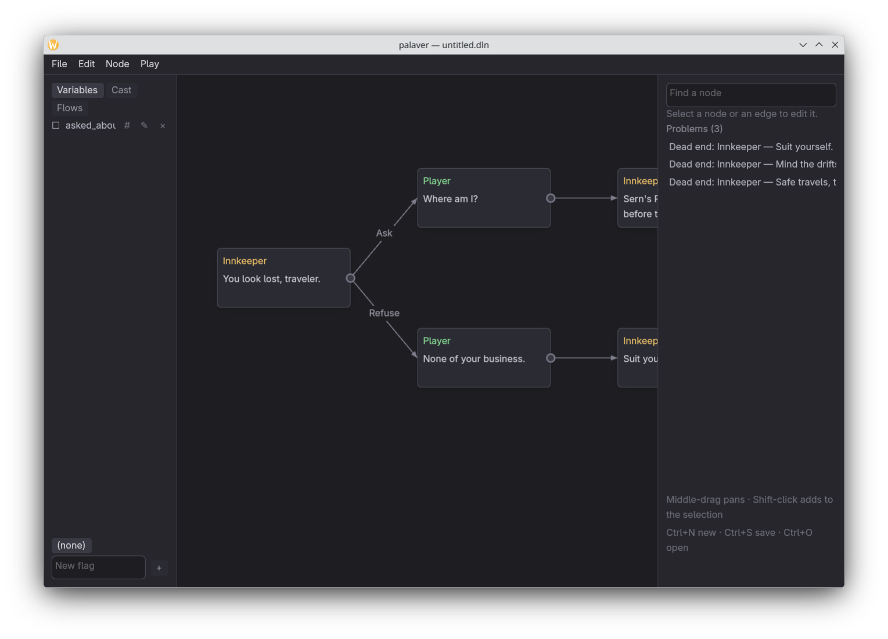</td>
<td>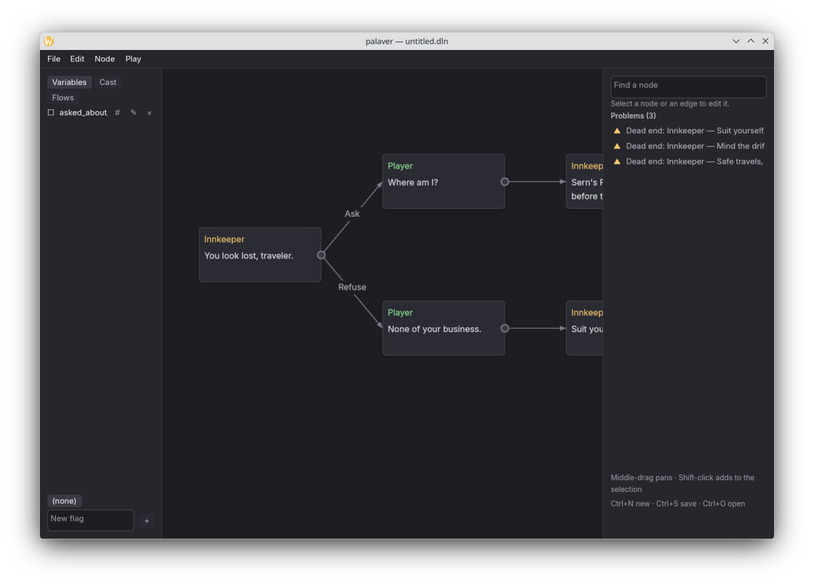</td>
</tr><tr><td align="center">before</td><td align="center">after</td></tr></table>

### Layout

The right sidebar used to hold the editor fields, the search box, the problems list and a
tips panel, all stacked the same way. Now it's an inspector: whatever is selected, in
sections, and nothing else. Things about the whole document (the problem count, which flow
you're on, the zoom, status messages, the file name) went into a status bar. Find, the
problems list and the shortcut sheet became overlays that are only there while you've got
them open.

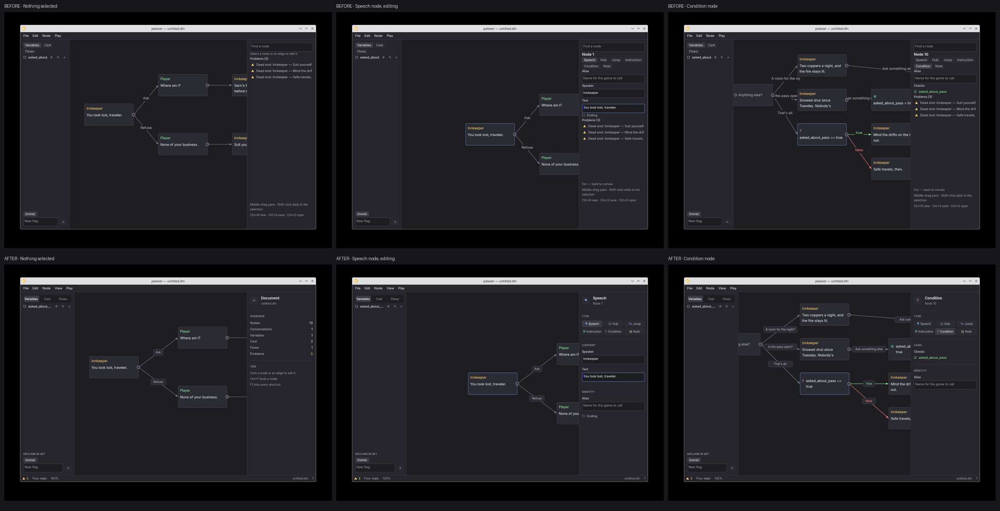

### Fit to view

A document opens fitted to the window, but never below 50%. The sample used to open as the
entire graph at 26%, which you couldn't read. Now it opens on the start of the conversation,
and you press F when you want the overview.

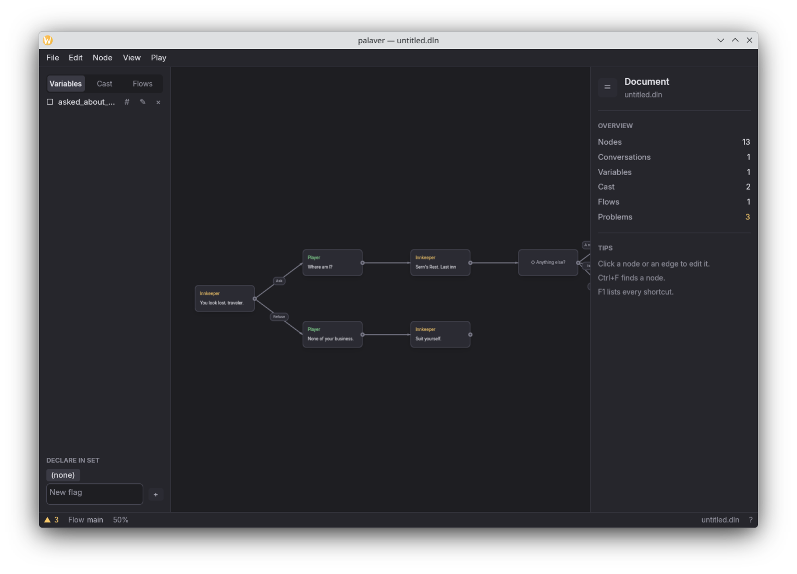

### Node kinds

Each node has a coloured strip down its left edge for its kind, so a speech node, a condition
and an instruction look different at a glance. A node that nothing links to gets a small
hollow ring at its in-port, which is how you spot where a conversation starts.

<table><tr>
<td>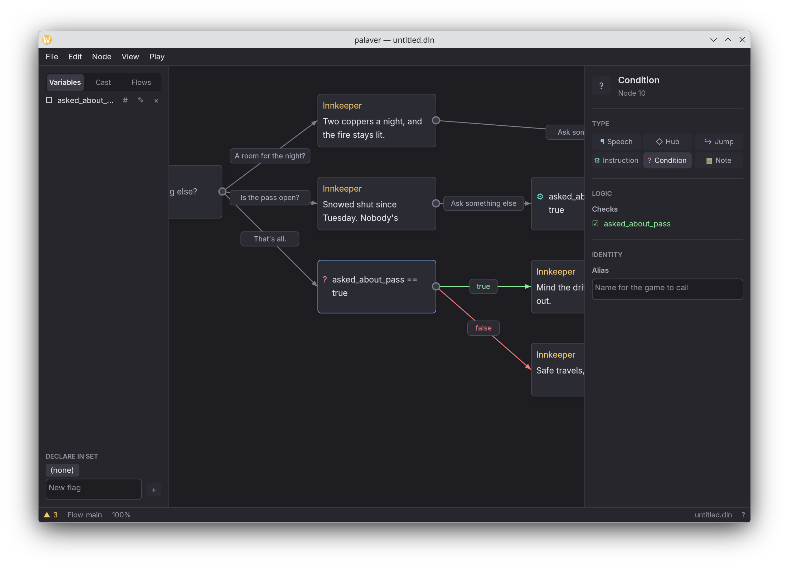</td>
<td>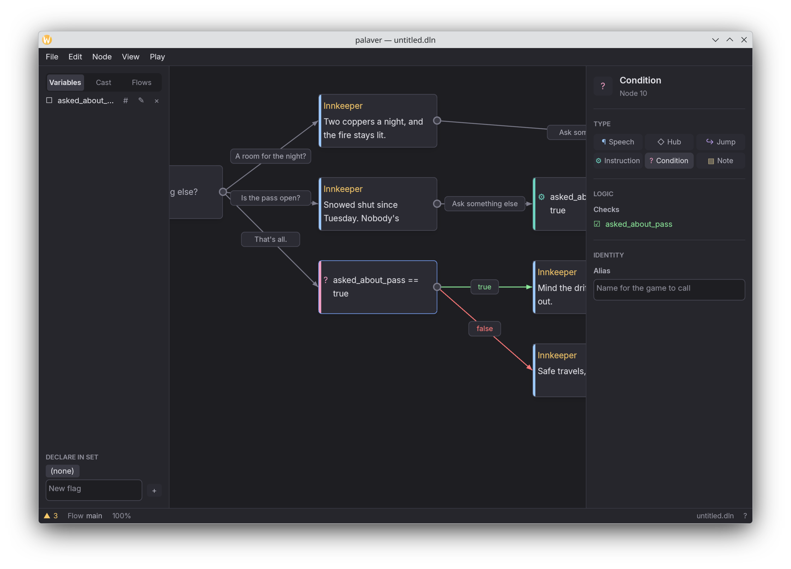</td>
</tr><tr><td align="center">before</td><td align="center">after</td></tr></table>

### Command palette

Ctrl+K opens it. It's built from the same table as the menu bar and the F1 sheet, so a name
or a shortcut can't be different in one place than in another.

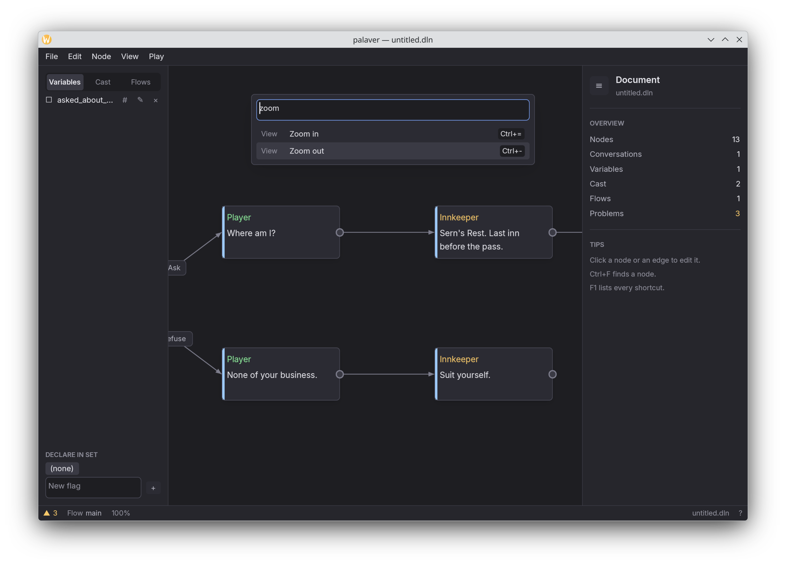

### Play trail

While a conversation is playing, the canvas shows the path so far. Edges you took are drawn
heavier, nodes you passed through are outlined, and once-only choices you've already used are
dimmed. It's in the clip at the top, and here it is in the light theme:

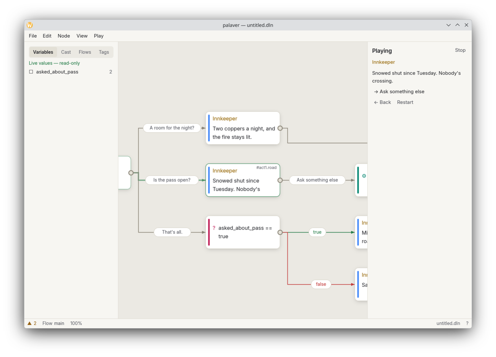

### Getting around

Search takes filters (`kind:cond`, `speaker:player`, `tag:act1`, `sets:gold`), and with
nothing typed it lists your bookmarks, which are just the nodes you've given an alias. Every
variable, character, flow and tag can show you where it's used. Ctrl+M opens the flow map:
one box per canvas, and an arrow wherever a jump crosses from one to another.

<table><tr>
<td>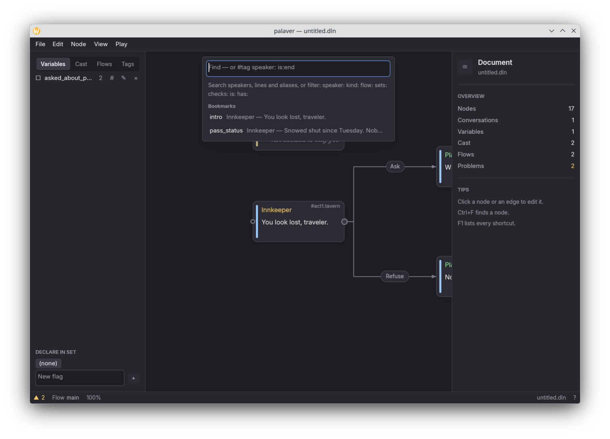</td>
<td>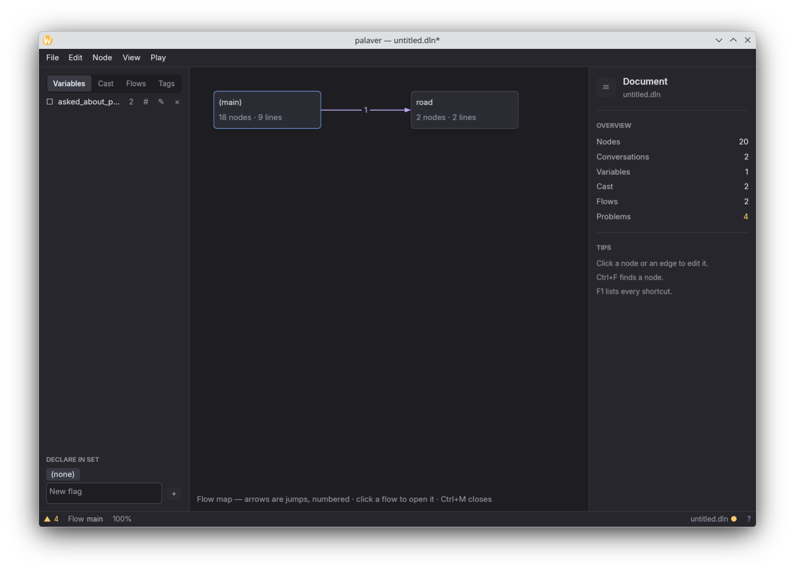</td>
</tr></table>

### Paper, and your own type

The last pass turned the look into preferences. There are two themes, Dark and a light one
called Paper, and they follow your desktop unless you tell them not to. Wires turned into
elbows along the way, so a hub's choices leave on a shared trunk and each label gets a run of
its own. Ctrl+, opens Preferences, where the UI font and the text font are separate. The text
font only applies to what characters say, so you can set the dialogue in Newsreader, or in
Courier if you want it to feel like a script, without changing what a variable name looks
like. All of the fonts are bundled, so it looks the same on any machine.

<table><tr>
<td>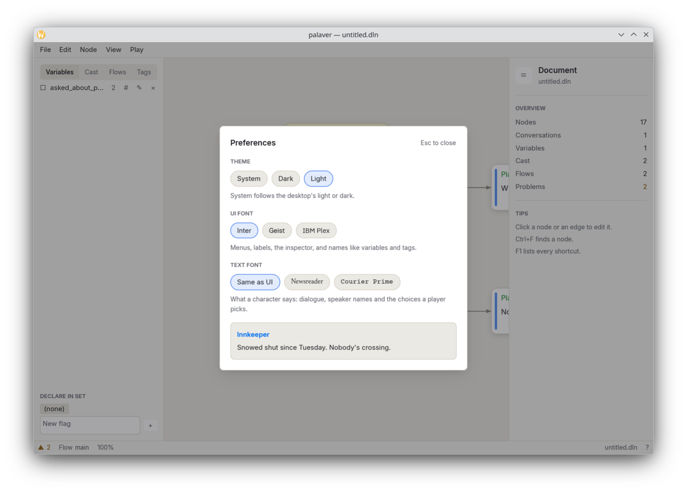</td>
<td>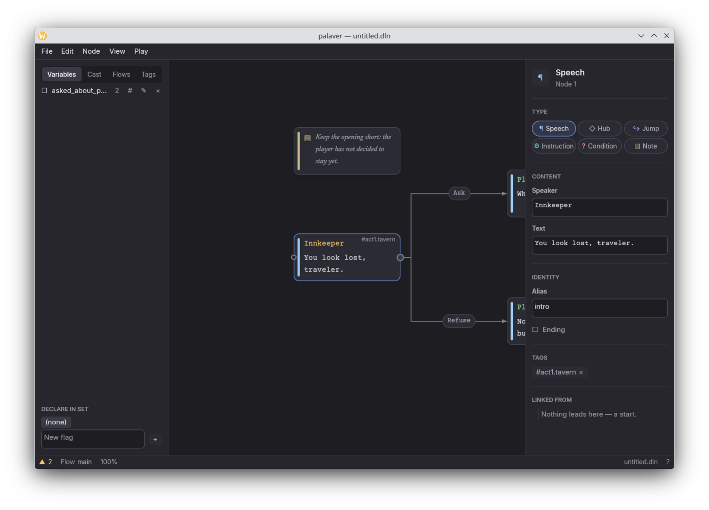</td>
</tr></table>

## How I checked it

`tools/shots.py` builds the editor, walks it through a fixed list of states over a small
automation socket, and screenshots each one. The states are the same every run, so a run
before a change and a run after are a fair comparison. Every screenshot above came out of it.
The clip at the top is `tools/record.py` doing the same thing inside a headless compositor
and keeping every frame.

Anything that involves the pointer (clicking an elbow wire, dragging a new one out of a port,
pressing Ctrl+, and clicking a font chip) I also ran with real keyboard and mouse events, not
just the socket. That turned up more than the unit tests did. Two bugs got past all of it
anyway, and I only caught them by looking at the screenshots: text typed into any overlay
field was black on near-black, and the palette could highlight two rows at once, one under
the mouse and one from the arrow keys.

## Build and run

```sh
cargo run --release
```

On Linux GPUI renders through Vulkan, so you'll need the Vulkan development packages plus
the X11 or Wayland ones. If the build fails inside a `blade-*` crate or in `gpui` itself,
it's almost always a missing system library rather than anything in here.

It opens on a small sample conversation with one of every node kind, a second flow, some tags
and two bookmarks, so there's something to click on straight away.

## Not done yet

There's no release binary, so for now you have to build it yourself.

[`CLAUDE.md`](CLAUDE.md) has the architecture notes and the list of things I decided not to
build. [`docs/next.md`](docs/next.md) is what I'd do next.

## License

GPL-3.0-or-later, see [LICENSE](LICENSE). The fonts in `assets/fonts` are under the SIL Open
Font License; their licence files sit next to them.
